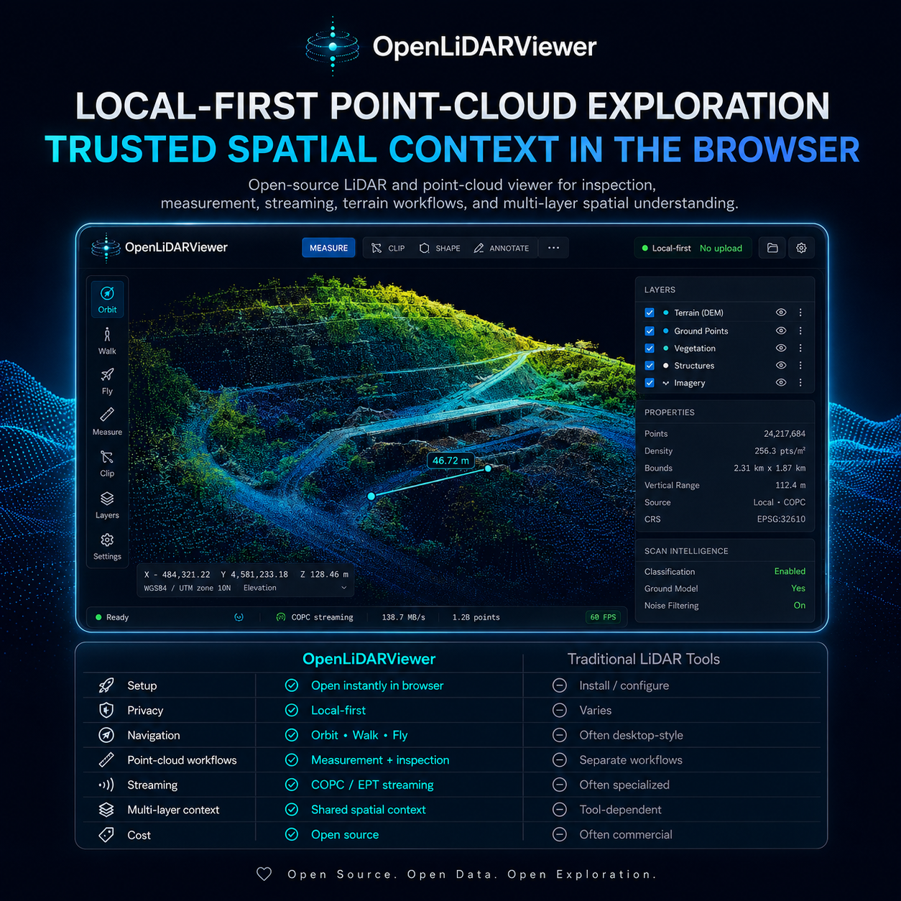
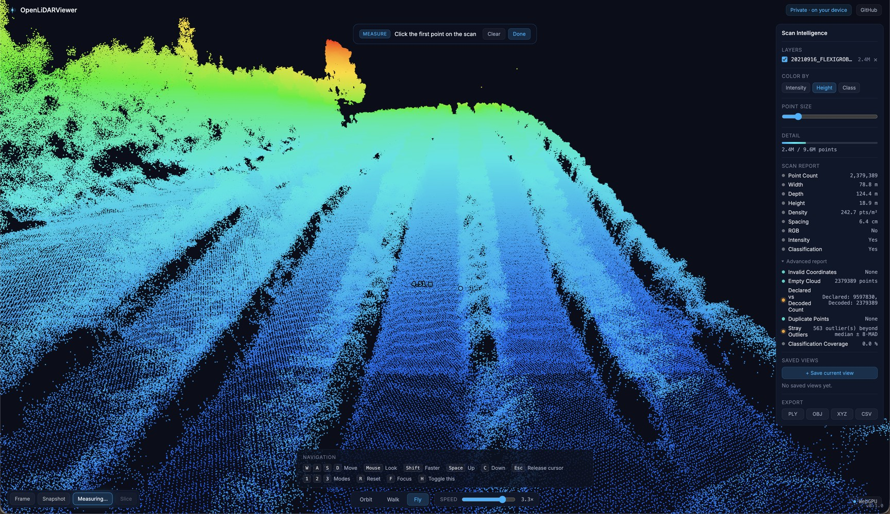
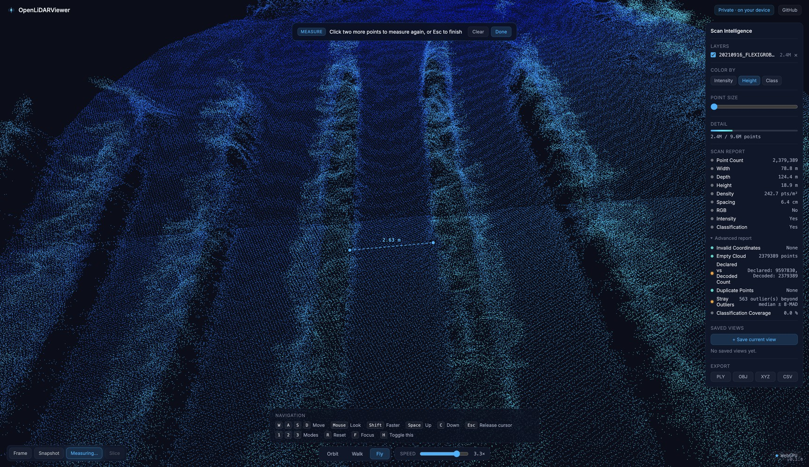
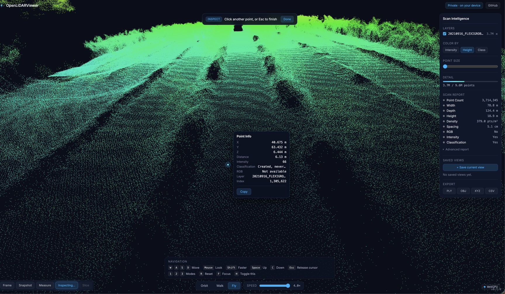
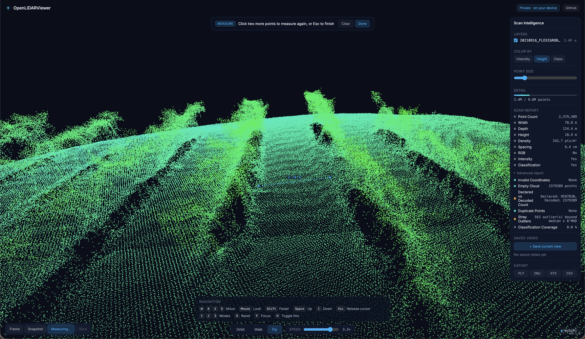

# OpenLiDARViewer

<p align="center"></p>

A browser-native LiDAR and point-cloud viewer for fast local inspection, 3D navigation, measurement, and terrain analysis. Local files are not uploaded.

[](https://github.com/Aurtechmx/openlidarviewer/actions/workflows/ci.yml)
[](https://github.com/Aurtechmx/openlidarviewer/actions/workflows/clean-clone.yml)
[](https://github.com/Aurtechmx/openlidarviewer/actions/workflows/benchmark-portability.yml)

[](https://github.com/Aurtechmx/openlidarviewer/actions/workflows/security.yml)
[](https://codecov.io/gh/Aurtechmx/openlidarviewer)
[](https://dashboard.stryker-mutator.io/reports/github.com/Aurtechmx/openlidarviewer/main)
[](https://sonarcloud.io/summary/new_code?id=Aurtechmx_openlidarviewer)

[](https://doi.org/10.5281/zenodo.21544619)
[](https://fair-software.eu)
[](https://github.com/Aurtechmx/openlidarviewer/releases/latest)
[](LICENSE)

## Try it in 10 seconds

No install, no account, no upload. Open [app.openlidarviewer.org](https://app.openlidarviewer.org/), then drag a `.las`, `.laz`, or `.copc.laz` file onto the page, or enter a remote COPC, `ept.json` or `tileset.json` URL in the Open from URL field. You're navigating the cloud in your browser, and a local file never leaves your device.

New here? The [User Guide](docs/USER_GUIDE.md) covers opening and measuring a scan. It also covers terrain analysis, comparing two scans and sharing your work. Full documentation, the format matrix, and the scientific validation record live at the [docs site](https://openlidarviewer.org/).

## Overview

OpenLiDARViewer opens LiDAR and point-cloud datasets straight in the browser. You inspect a scan, navigate it in 3D, change how it is coloured, measure, run terrain analysis and export the results, with no desktop GIS to set up. Files are read and rendered locally, so there is no server to upload to.

It is a viewer and an inspection tool, not a GIS or a survey-grade processing suite. Results state their basis, and terrain and contour exports require sufficient evidence.

## Features

- Inspect point-cloud datasets in a modern web interface, with nothing to install and nothing uploaded.
- Open drone LiDAR (LAS, LAZ) and terrestrial laser-scanner data (E57, PTX, PTS). Phone and mobile scan exports (PLY, OBJ, GLB/GLTF, XYZ, CSV) and Point Cloud Library (PCD) files open too.
- Stream large COPC and EPT datasets progressively, octree node by octree node, with bounded memory and no full-file load.
- Navigate game-style: Orbit, Walk, Fly, and Pan modes with WASD and mouse-look, plus Top / Iso / Oblique / Planar camera presets.
- Measure distance, polyline, area, height, angle, slope, cross-section profile, and volume cut/fill, with editable points and JSON session export/import.
- Run a confidence-aware DTM and contour pipeline: ground classification, gridded DTM with hold-out RMSE, surface models, and evidence-gated contour and DEM export.
- Click any point to read its coordinates, intensity, classification, GPS time and colour. The Scan Intelligence panel summarises the dataset, and findings can be annotated and composed into multi-page PDF reports.
- Switch interface themes (Blue / Field / High contrast), drive everything from a command palette (`Cmd-K`), and work one-handed on mobile.

OpenLiDARViewer does not claim survey-grade measurement or support for every LiDAR format. See [Limitations](#limitations) and the details below.

<details>
<summary><b>Core viewer</b></summary>

- Browser-based point-cloud visualization, no install
- Local-first scan inspection, nothing is uploaded
- WebGPU rendering with an automatic WebGL 2 fallback
- Import: LAS, LAZ, E57, PLY, OBJ, GLB, GLTF, XYZ, CSV, PCD, PTX, PTS
- Export: LAS (1.2 / 1.4), PLY, OBJ, XYZ, CSV, and PNG snapshots
- Budget-aware fast loading of large LAS/LAZ surveys: header preflight, stride decoding, a memory-safety guard, staged progress, and a load that can be cancelled mid-flight
- Chunked, bounded-memory reading of large text point clouds (XYZ, CSV, PTS); a large survey reduces in density instead of crashing on weak devices
- A universal file-open summary and clear, categorised load-error messages
- A coordinate bridge that keeps large georeferenced (UTM-scale) coordinates numerically stable
</details>

<details>
<summary><b>Streaming</b></summary>

- A COPC `.copc.laz` file, on disk or hosted at a URL, opens through progressive, octree-based, view-dependent streaming with worker-based decoding and bounded memory, never a full-file load. A remote scan opens from the start screen's Open from URL field or a shareable `?copc=<url>` deep link; the deep link asks for confirmation naming the host before anything is requested
- EPT (Entwine Point Tile) streaming: local and remote, `binary` and `laszip` tiles
- 3D Tiles / `.pnts`: a single `.pnts` tile opens as a point cloud. It is detected by its magic bytes, decoded from uncompressed or quantised positions with colour, and placed by its `RTC_CENTER`
- 3D Tiles / `tileset.json`: a 3D Tiles 1.0 or 1.1 point-cloud (PNTS) tileset streams from a URL like COPC and EPT, including implicit tiling, external child tilesets and both refinement modes. Mesh content and Draco are refused. See [`docs/supported-formats.md`](docs/supported-formats.md) for the supported subset
- A curated catalog of 12 hand-vetted public COPC / EPT datasets
- Remote URLs on a local or private network are refused. An EPT hierarchy of more than 2,000,000 nodes is read only up to that point, and a COPC data node above 128 MiB is dropped

See [`docs/streaming.md`](docs/streaming.md) and [`docs/copc.md`](docs/copc.md).
</details>

<details>
<summary><b>Navigation & camera</b></summary>

Game-like navigation lets a scan be explored like a 3D environment.

- Orbit, Walk, Fly, and Pan (hand-tool) modes with WASD movement and mouse-look
- Smart camera presets (Top, Iso, Oblique, Planar): one-click jumps that frame the cloud from a known angle
- A triangular nav widget that surfaces the current mode and a centre Reset
- Saved, renamable camera views for repeatable inspection
- Shareable view links: Copy view link reproduces the current view (camera, colour mode, point sizing); no scan data is shared, the recipient still needs the same file
- Movement speed scales with the size of the loaded scan

| Control | Action |
|---|---|
| W / A / S / D | Move through the scan |
| Mouse | Look around (click the scan to capture the cursor) |
| Shift | Move faster |
| Space | Move up |
| C / Ctrl | Move down |
| Esc | Release the cursor |
| R | Reset / re-frame the view |
| F | Focus on the point at the centre of the view |
| 1 / 2 / 3 / 4 | Orbit / Walk / Fly / Pan mode |
| G | Toggle the Pan (hand) tool |
| Middle-drag | Pan the view in any mode |
| Double-click | Fly to the clicked point |

Orbit suits inspecting an area from the outside, Pan is the 1:1 hand tool, Walk suits interiors and street-level scans, and Fly suits drone LiDAR, terrain, and wide-area scans. Full detail is in [`docs/navigation.md`](docs/navigation.md).
</details>

<details>
<summary><b>Rendering</b></summary>

Rendering is tuned so a point cloud reads as a 3D surface, not a flat wash of dots.

- Eye Dome Lighting (EDL): screen-space depth shading that darkens depth discontinuities so edges, ridges, and near/far structure become legible. It runs as a post-processing pass targeting both the WebGPU and WebGL 2 backends from one node graph, with strength, radius, and three named presets (Subtle / Balanced / Inspection). On by default on desktop WebGPU, off by default on the WebGL 2 fallback and on mobile, where it can still be switched on
- Hillshade relief overlay from the terrain surface model for topographic readability
- Soft splat rendering: Classic round points, Soft splats, or Inspection mode with density-aware radius
- Adaptive or fixed point sizing, round antialiased points, and a Detail control that shows the `shown / total` count
- Height, intensity, classification, RGB, and surface-normal colour modes, picked automatically per file
- Percentile-clipped height mode with a 5/95 default and the Viridis palette by default; Turbo and the other palettes are selectable
- HDR sky presets: Studio Dark, Blueprint, Survey Light, Terrain, Black
</details>

<details>
<summary><b>Visuals Studio</b></summary>

- A unified Inspector section with three chip rails (Colour Mode, RGB Preset, Sky / EDL) that re-style the scan without leaving the panel
- RGB appearance presets (Natural, Photoreal, Drone RGB, Mobile LiDAR, Survey, High Contrast), each tuning gamma, contrast, saturation, and exposure
- White balance (temperature + tint) with an Auto-balance assist, gated to streaming COPC where it can sample residency
- Patch view at the inspector cursor: a KNN-based tangent-plane projection of the point's neighbourhood with a photometric witness panel
</details>

<details>
<summary><b>Measurement & analysis</b></summary>

Open the Measure tool, pick a kind from the toolbar, and place points directly on the scan. Nine tools are available.

| Tool | What it measures |
|---|---|
| Distance | Straight-line distance between a pair of points |
| Polyline | Total length of a multi-segment path |
| Area | Polygon area, both true in-plane and horizontal (map-projected) |
| Height | Vertical difference between a pair of points |
| Angle | The angle at a vertex between two arms |
| Slope | Rise, run, slope angle, and grade percentage between a pair of points |
| Profile | Cross-section between a pair of points: 3D length, horizontal distance, vertical drop, and grade |
| Box | An axis-aligned box from two opposite corners: width, depth, height, and volume |
| Volume | Cut and fill against a base level, from a polygon or a 3D lasso |

- Every measurement is editable: drag a point, undo the last point while placing, rename, or clear. Placed measurements list in a compact panel and persist for the session. One toggle switches all readouts between metric and imperial. The set exports to a JSON session file and re-imports later
- Cross-section profile renders a height-vs-distance chart strip under the row, 280 px tall by default and resizable from 160 px to 640 px so the curve reads at deliverable size
- Volume (cut / fill) against a polygon or 3D lasso, with NaN / degenerate / self-intersection guards and a streaming-resident caveat when nodes are still loading
- Classification editor: paint a class id over a lassoed selection and write the result back to LAS
- Density heatmap overlay for coverage QA, box clipping / slicing for interactive cross-cuts, and measurement chains that combine placed measurements as sum / difference / ratio
- A Scan Intelligence panel with point count, dimensions, density, spacing, attributes, and an Advanced report of integrity diagnostics
- A Dataset Intelligence card (header-derived Point Density, Terrain Complexity, Ground Visibility, Streaming Coverage, Terrain Confidence) that leaves a row blank when no signal is available
- Point inspection: click a point to read its coordinates and attributes (LAS return number, point source ID, GPS time, and UTM + lat/lon when a CRS is known), with one-click copy, or hover with the live probe for a click-free readout
- Capture provenance from LAS/LAZ and E57 headers (sensor, source software, date), shown in the Scan Report when the file carries it

Measurement is meant for visual inspection and research, not survey-grade use. OLV makes no survey-grade claim; if accuracy matters, check against ground control using your own procedures.
</details>

<details>
<summary><b>Terrain Intelligence & Contour Studio</b></summary>

OpenLiDARViewer ships a terrain analysis stack under `src/terrain/`. Shared type contracts (`TerrainContracts.ts`) give every stage one coverage envelope: a coverage mode (`full` / `resident-only` / `sampled`), the source and analyzed point counts, a 0-100 confidence value, and ordered warnings, so an analyser never implies full-cloud certainty when only resident streaming nodes were walked.

The Analyse panel runs a confidence-aware DTM and contour pipeline: ground classification, a gridded DTM with per-cell confidence and hold-out RMSE, surface models (DSM, canopy height, slope, hillshade), a Terrain Assessment verdict, evidence-graded contour export (GeoJSON, SVG, DXF), a printable map sheet and a georeferenced DEM package (ASCII Grid + GeoTIFF). Ground classification is heuristic and not survey-grade. Treat terrain products as export-ready only when the Terrain Assessment reads Good, and as preview otherwise. The Dataset Intelligence card in the Inspector is a lighter, header-only summary.

Contour Studio turns an analysed scan into a contour deliverable. Pick a purpose (Engineering Plan, Survey Review, Terrain Research, Presentation Map or Custom); it sets presentation defaults only. Analytical contours are exact isolines of the grid; cartographic contours are smoothed for legibility and never labelled exact. Every export passes one evidence gate: blocked products return a diagnostic, exploratory ones are watermarked. Exports include GeoJSON, DXF and SVG contours, a map-sheet PDF, a DEM package, a terrain report and a ZIP with SHA256SUMS. Accuracy figures are internal hold-out only, and no output is survey-grade or certified.

See [`docs/terrain-intelligence.md`](docs/terrain-intelligence.md), [`docs/validation/terrain-validation-matrix.md`](docs/validation/terrain-validation-matrix.md), and [`docs/contour-studio.md`](docs/contour-studio.md).
</details>

<details>
<summary><b>Annotation, sessions & reporting</b></summary>

- Annotations are categorised, titled markers with notes. You can browse and search them, and each one captures the camera viewpoint; undo and redo cover every edit. The panel and the PDF report open with a grouping summary (totals, per-category counts, and how many areas the notes fall across)
- Inspection sessions: export measurements, annotations, and named views to one JSON file and reload them later
- The workflow recorder records and replays `.olvworkflow` files of camera moves and tool actions. Its settings cover the file format, save destination and start/stop shortcut. Replay has its own speed and loop options, recording can start after a countdown, and you choose which action families are captured. It records actions only, never scan data, so a recipient needs the same scan open to replay
- Multi-page PDF technical reports: three built-in templates (Survey Summary, Technical Report, Scan QA) with branding and unit-system awareness
- Visual Export Studio: orthographic RGB, height map, intensity, classification, depth, normal, and contour map exports
- Screenshot export that burns in placed measurements and annotations as inspection evidence
</details>

<details>
<summary><b>Interface & accessibility</b></summary>

- Interface themes (Blue, Field, High contrast) with a persisted preference
- A colourblind-safe (Okabe-Ito) classification palette, toggled from the Classes panel, so ground, vegetation, buildings, and water stay distinguishable under the common colour-vision deficiencies
- Command palette (`Cmd-K` / `Ctrl-K`) for keyboard-first access to every tool, mode, theme, and export
- Searchable shortcut sheet (`?`) listing every keybinding, plus a built-in help overlay
- An onboarding tour through the empty state, tool dock, and Inspector
- A mobile touch model with twist + pinch + pan decomposition, sub-threshold dead zones to stop accidental wobble, and an opt-in 3-finger zoom
- A mobile Scan Intelligence bottom-sheet with peek + tap-to-toggle, and an overflow "More" disclosure on the tool dock so the primary row stays one-handed
</details>

<details>
<summary><b>Multi-scan & embed</b></summary>

- Open multiple scans as layers, or close the current scan from the tool dock to start fresh with another
- An embed mode for `<iframe>` use (`?embed=1`), with a validated `postMessage` bridge for host-page control. On a host that cannot send headers, the viewer's own frame guard blocks cross-origin embedding unless the deployer listed the parent origin at build time; see the [embed reference](docs/usage.md#embed-reference)
- Developer diagnostics: a live performance overlay (`?debug=1`) and a structured benchmark mode (`?benchmark=1`)
</details>

## Screenshots

| | |
|---|---|
|  |  |
| A 9.6M-point drone survey, height-colored, with the Scan Intelligence panel and Orbit / Walk / Fly navigation. | The measurement toolkit: here a distance between two picked points. |
|  |  |
| Inspecting a point: a glowing marker and a card with its real-world coordinates and attributes. | The Scan Intelligence panel lists point count, dimensions, density and spacing. Attributes and the Advanced report sit below. |

More in [`docs/screenshots.md`](docs/screenshots.md).

## Formats & requirements

Import: `LAS`, `LAZ`, `E57`, `PLY`, `OBJ`, `GLB`, `GLTF`, `XYZ`, `CSV`, `PCD`, `PTX`, `PTS`.
Export: `LAS` (1.2 / 1.4), `PLY`, `OBJ`, `XYZ`, `CSV`, and `PNG` snapshots.

For large datasets, stream COPC (`.copc.laz`) or EPT (`ept.json`), which load progressively with bounded memory. For lightweight sharing, use PLY or GLB.

<details>
<summary><b>Format matrix and compatibility notes</b></summary>

That covers phone and mobile scan exports (PLY, OBJ, GLB/GLTF; `USDZ` needs conversion first), terrestrial laser-scanner data (E57, PTX, PTS), georeferenced drone LiDAR (LAS/LAZ) and PCD in all three encodings. E57 support is a tested subset; no conformance to ASTM E2807 is claimed. Large COPC and EPT datasets stream progressively from disk or a URL with bounded memory.

Format support depends on the device (browser memory, GPU capacity) and on the data: its size, how it was preprocessed, and how complete OLV's reader for that format is. The per-format detail, including scanner and app compatibility, is the format matrix in [`docs/supported-formats.md`](docs/supported-formats.md).
</details>

<details>
<summary><b>System requirements</b></summary>

OpenLiDARViewer needs a browser with WebGL 2.0 and hardware acceleration; performance depends on the dataset and the device. A Chromium-based browser (Chrome, Edge, Brave) is recommended. WebGPU is used automatically where available, with WebGL 2 as the fallback. Per-browser details are in `docs/developer-manual.md` section 14.

| Component | Minimum | Recommended |
|---|---|---|
| CPU | Modern dual-core | Quad-core or better |
| RAM | 8 GB | 16 GB or more |
| GPU | Integrated GPU with WebGL 2.0 | Dedicated GPU, or a modern integrated GPU |
| Browser | WebGL 2.0 compatible | WebGL 2.0 and WebGPU-capable |

Very large datasets are best handled as COPC or EPT; other very large formats may need downsampling or preprocessing. See [`docs/copc.md`](docs/copc.md) and [`docs/performance.md`](docs/performance.md).
</details>

<details>
<summary><b>Mobile browser support</b></summary>

OpenLiDARViewer includes a mobile-friendly interface for opening compatible point-cloud and 3D scan files from phones and tablets. On mobile: files open from the device file picker or a cloud file provider, Scan Intelligence shows as a compact panel, navigation uses touch gestures, measurement uses tap-based point selection, and rendering defaults to a mobile-safe performance mode.

A typical workflow: export a scan from a phone scanning app as GLB/GLTF, OBJ or PLY, open OpenLiDARViewer in a mobile browser, tap "Open scan from device," then inspect, measure and export. Export options differ between apps, and some need a paid plan.

On mobile, the browser, GPU and memory set the ceiling, and file size and point count decide how close a scan gets to it. Very large datasets may require desktop hardware, downsampling, tiling, or optimized formats. Full detail is in [`docs/mobile-browser-support.md`](docs/mobile-browser-support.md).
</details>

## Getting started

```bash
git clone https://github.com/Aurtechmx/openlidarviewer.git
cd openlidarviewer
npm install
npm run dev
```

Open the local URL it prints, then drop a scan onto the page, or press "Launch a sample", which streams the swissSURFACE3D sample (83.8 MB) over the network. To build for static hosting (any static host or CDN, since it is just files):

```bash
npm run build
npm run preview
```

<details>
<summary><b>Using the viewer</b></summary>

1. Open the app in a modern WebGL/WebGPU-capable browser.
2. Drop a compatible point-cloud file onto the page.
3. Choose a colour mode: Height, Intensity or Classification, or RGB and Normal where the file carries them.
4. Adjust point size and rendering detail.
5. Navigate with Orbit, Walk, or Fly mode.
6. Read the Scan Intelligence panel for dataset metadata and quality.
7. Measure distance, polyline, area, height, angle, slope, or cross-section profile inside the point cloud.
8. Annotate points of interest with categorised notes, and inspect or probe individual points.
9. Save viewpoints for repeated inspection.
10. Export a PNG snapshot, re-export the cloud as PLY, OBJ, XYZ, or CSV, or save the full working state as a `.olvsession` package.
11. Close the scan (Close scan in the tool dock) to return to the start and open another.

A fuller walkthrough is in [`docs/usage.md`](docs/usage.md).
</details>

<details>
<summary><b>Recommended workflows</b></summary>

Each assumes a single drag-and-drop or URL open, with everything happening locally in the browser.

- Large streaming dataset review. Open COPC (`.copc.laz`) or EPT (`ept.json`), local file or remote URL. Navigate at interactive frame rates against datasets far larger than browser memory; the scheduler streams only what the current view needs.
- Inspection reporting. Annotate findings, measure distances / areas / slopes / angles / profiles, then export a multi-page PDF report (cover, dataset summary, embedded image exports, annotations, measurements, technical notes). Three templates and brand-aware accent + logo support.
- Terrain analysis. Export height maps from drone LiDAR with legend customisation and unit-system control, useful for slope review, elevation comparison, and quick topographic figures. Cross-section profiles report 3D length, horizontal distance, vertical drop, and grade across any two picked points.
- Classification QA. Export classification maps, toggle the colour mode to highlight specific classes, place annotations on misclassified regions, and round-trip the working state through `.olvsession`.
- Mobile scan review. Open lightweight datasets (`.glb`, `.ply`, `.obj` from a phone scanning app) on tablets or phones. The viewer adapts rendering detail and EDL defaults for weaker GPUs so a phone scan is readable from the first frame.
</details>

## Under the hood

<details>
<summary><b>How it works</b></summary>

1. You load a dataset by dropping a file, or with "Launch a sample", which streams the swissSURFACE3D sample (83.8 MB) over the network.
2. The format is detected from the file's magic bytes first, then its extension.
3. The file is parsed off the main thread, inside a Web Worker.
4. Point positions and attributes are decoded. Large georeferenced coordinates are recentered in double precision before the float32 downcast.
5. Clouds above the point budget are stride-decoded or voxel-downsampled, and the Detail control shows the `shown / total` count.
6. The cloud renders through a WebGPU or WebGL 2 pipeline built on three.js; Eye Dome Lighting adds screen-space depth shading as a post-processing pass.
7. Color modes map height, intensity, classification, RGB, or surface-normal direction onto the points, sized adaptively with distance.
8. You explore with Orbit, Walk, or Fly navigation.
9. Scan Intelligence summarizes the dataset, and the measurement toolkit takes its measurements.
10. You save viewpoints and export snapshots, re-exported point data, or a JSON measurement session.
</details>

<details>
<summary><b>Technology stack</b></summary>

- TypeScript in strict mode, across the IO, model, and render layers
- three.js (`three/webgpu`), a WebGPU renderer with a WebGL 2 fallback
- A `three/tsl` node-graph post-processing pipeline (Eye Dome Lighting) that targets both backends from one shader description
- loaders.gl and laz-perf (WASM) for mesh and LAZ parsing, plus a from-scratch TypeScript E57 parser
- Vite for the build and dev server, with Web Worker and WASM handling
- Vitest and Playwright for unit and end-to-end tests
- A client-side, local-first pipeline with no backend
</details>

<details>
<summary><b>Architecture</b></summary>

OpenLiDARViewer is modular, with one file per format and one file per concern. Loading and parsing, the coordinate bridge and render-buffer generation each sit in their own modules. Color modes, navigation, measurement, Scan Intelligence and export are separate subsystems as well. See [`docs/architecture.md`](docs/architecture.md) and the [Developer Manual](docs/developer-manual.md).
</details>

<details>
<summary><b>Performance notes</b></summary>

Point count, browser memory and GPU capability matter most for performance. A LAS/LAZ file is planned from its header before it is read: a cloud above the device's point budget (roughly 3M points on a capable desktop, less on weaker hardware) loads at reduced density, with a memory guard, staged progress and a cancellable load. COPC, EPT and very large LAS/LAZ stream only what is visible. The Detail readout shows the `shown / total` count.

COPC streaming (local and remote) uses a view-dependent scheduler, hierarchy-aware eviction, a dispatch-pressure gate that bounds residency under 1B-synthetic-point stress, and picking against actively refining clouds. EPT streams through the same scheduler.

For real-world figures (a 9.6M-point drone LAZ survey and a 55K-point phone scan, both from one drag-and-drop) see [`docs/benchmarks.md`](docs/benchmarks.md), [`docs/performance.md`](docs/performance.md), and [`docs/streaming.md`](docs/streaming.md).
</details>

## Limitations

OpenLiDARViewer is a viewer, not a replacement for a GIS or a survey-grade processing tool. Analysis and comparison use each scan in its own frame and do not reproject.

- Large files are limited by browser memory and GPU performance; some formats need preprocessing or conversion before they load, and format support is still evolving.
- Measurement is for visual inspection, not survey-grade use.
- Metric figures are withheld when the CRS linear unit is unconfirmed; extents are shown in the source unit.
- Reprojection exists only on export, in the Export tab and the batch converter. It transforms X and Y, applies no vertical-datum shift, and refuses NAD27.
- Classification visualization depends on attributes present in the file.
- Very large datasets stream as COPC or EPT, and a very large LAS or LAZ is indexed into browser storage; other huge formats may still need tiling or downsampling.
- WebGPU feature support varies by browser, with the WebGL 2 fallback used otherwise. Eye Dome Lighting is a screen-space depth cue, not physically-based lighting, and is off by default on the WebGL 2 fallback and on mobile.

Full detail is in [`docs/limitations.md`](docs/limitations.md).

## FAQ

Can I view LAS / LAZ / COPC files in the browser?
Yes. Drag a `.las`, `.laz`, or `.copc.laz` onto [app.openlidarviewer.org](https://app.openlidarviewer.org/), or enter a remote COPC / `ept.json` URL in the Open from URL field. No install, no plugin.

Is my data uploaded anywhere?
No. Files from your device are read and rendered locally and are not uploaded. The app requests its own files, any remote dataset or sample you open, and, only when you run a location search, the public LiDAR catalogue (Microsoft Planetary Computer). The full list is in [PRIVACY.md](PRIVACY.md).

What's the largest scan it can open?
Most local files are bounded by browser memory and the GPU. A very large uncompressed LAS or chunked LAZ is indexed into browser storage and streamed, and reopening the same file reuses that index. The browser may clear it. When storage is too small, an evenly spread sample of the file opens instead and says so.

For anything else too large, stream it as COPC or EPT, or convert it with PDAL or Entwine. Streaming loads only the set the camera needs.

Which formats are supported?
For static loads, LAS / LAZ, PLY, OBJ, PCD, PTX, PTS, XYZ / CSV, E57 and glTF / GLB; for streaming: COPC, EPT, a 3D Tiles PNTS tileset, and a very large uncompressed LAS or chunked LAZ indexed out of core. See [Formats & requirements](#formats--requirements).

Is it survey-grade?
No. Measurements and quality grades describe the data you loaded; they are not a survey-grade certification. Validate against ground control where accuracy matters.

Does it need WebGPU?
No. WebGPU is the primary path and it falls back to WebGL 2 automatically.

## Project & research

OpenLiDARViewer started as an experiment: how far can modern browser technology go in making LiDAR and point-cloud data easy to reach? It explores browser-native rendering, lightweight WebGL/WebGPU pipelines, human-centered interaction with 3D data, game-inspired navigation for technical inspection, and local-first workflows. It does not try to replace full GIS or survey-grade processing. The goal is a quick way to open a point cloud, look around it and measure it, and then present what you found. See [`docs/research-notes.md`](docs/research-notes.md).

The current release is **v0.7.1-alpha.1**, an alpha on the way to v0.7.1 with no tag and no DOI; the latest published release is v0.7.0 ([release notes](docs/releases/RELEASE_NOTES_v0.7.0.md), [validation report](docs/releases/VALIDATION_REPORT_v0.7.0.md), [known limitations](docs/releases/KNOWN_LIMITATIONS_v0.7.0.md)). The dated history is in [CHANGELOG.md](CHANGELOG.md), and per-release records live in [`docs/releases/`](docs/releases/).

### Help test OpenLiDARViewer

OpenLiDARViewer improves through feedback from people who work with point clouds day to day: GIS, drone mapping, terrain analysis, hydrology, surveying, web mapping. Open a workflow you already know, on the live demo or a local build. Use one of your own authorised files, compare the values you care about against the tool you normally trust, and say what worked, what failed, and what was unclear.

The quick report takes five to ten minutes. A longer comparison against a reference tool (metadata, CRS, units, elevations, measurements, terrain products) is optional. Participation is voluntary and unpaid. Please do not submit confidential, restricted, or personal information, and do not send source datasets you are not free to redistribute. A failed file, an unexpected warning, or one confusing screenshot is worth sending. Email what you found to <info@aurtech.mx>.

## Validation & reproducibility

For reviewers:

- [REVIEWER_QUICKSTART.md](REVIEWER_QUICKSTART.md): install and run the offline test suite from a clean clone.
- [VALIDATION_REPORT_v0.7.1-alpha.1.md](docs/releases/VALIDATION_REPORT_v0.7.1-alpha.1.md): what v0.7.1-alpha.1 validates and what it does not. The register holds 41 claims, 18 of them at E4 and none at E5. Since v0.7.0, TERRAIN-FLOW-PULSE moved from E3 to E4 after a comparison with TauDEM and GRASS GIS, TERRAIN-FLOW-DEPRESSION-INVENTORY moved from E2 to E3, and two claims are new: MEAS-BOX for box volume (E3) and STORAGE-HISTORY for the scan report's storage grid test (E2).
- [KNOWN_LIMITATIONS_v0.7.1-alpha.1.md](docs/releases/KNOWN_LIMITATIONS_v0.7.1-alpha.1.md): the documented limits of this release.
- [REPRODUCIBILITY.md](REPRODUCIBILITY.md): the pinned toolchain and the steps to reproduce the build, tests, and reported figures.
- [ARTIFACT_EVALUATION.md](ARTIFACT_EVALUATION.md): how to evaluate the artifact without special hardware or private data.
- [DATA_AVAILABILITY.md](DATA_AVAILABILITY.md): where the test fixtures and streamed sample datasets come from, and how they are licensed.

## Contributing

Contributions are welcome. See [CONTRIBUTING.md](.github/CONTRIBUTING.md), the [security policy](.github/SECURITY.md), and the [code of conduct](.github/CODE_OF_CONDUCT.md). The codebase is test-first (Vitest and Playwright), written in strict TypeScript, and organized around explicit module boundaries.

## Acknowledgements

Built on [three.js](https://github.com/mrdoob/three.js) (rendering), [loaders.gl](https://github.com/visgl/loaders.gl) (format parsing), [proj4js](https://github.com/proj4js/proj4js) (CRS transforms), [pdf-lib](https://github.com/Hopding/pdf-lib) (reports), and [laz-perf](https://github.com/hobuinc/laz-perf) (LAZ decoding). Full licenses in [THIRD_PARTY_NOTICES.md](docs/project/THIRD_PARTY_NOTICES.md).

The streamed sample datasets are limited to sources with a confirmed open licence: [USGS 3DEP](https://www.usgs.gov/3d-elevation-program) (public domain) and the swisstopo and GURS national programmes (via FLAI). Providers and terms are listed in [docs/credits.md](docs/credits.md).

Beta testing: A. Ballesteros ([ORCID 0009-0003-3394-0699](https://orcid.org/0009-0003-3394-0699)).

Format specifications OLV builds against (no conformance claimed): ASPRS (LAS/LAZ), the Khronos Group (glTF/GLB), ASTM (E57), and OGC / IOGP-EPSG (coordinate systems). The viewer relies on laz-perf, COPC and Entwine from Hobu, Inc.

## Citation & research collaboration

OpenLiDARViewer v0.6.7 and later is licensed under AGPL-3.0-only. If the software, its validation framework, algorithms or documentation helped your work, please cite it. GitHub's "Cite this repository" button reads [CITATION.cff](CITATION.cff) and gives the current reference, including BibTeX.

Independent reproduction, surveyed-checkpoint datasets, cross-checks against reference tools and method comparisons are welcome. Open an issue or a discussion; details are in [docs/collaboration/RESEARCH_COLLABORATION.md](docs/collaboration/RESEARCH_COLLABORATION.md).

## License

OpenLiDARViewer v0.6.7 and later is licensed under the GNU Affero General Public License v3.0 only (AGPL-3.0-only). See [LICENSE](LICENSE). Releases through v0.6.6 were distributed under the MIT License and remain available under those original terms.

OpenLiDARViewer is provided as is, without warranty of any kind; see sections 15 and 16 of the GNU AGPL.

Files you open are processed on your device and are not uploaded, and the app has no analytics or telemetry. See [PRIVACY.md](PRIVACY.md).

Commercial licensing may be available separately from Aur Technologies for eligible components and use cases such as closed-source embedding, OEM redistribution, or proprietary integration. See [LICENSING.md](LICENSING.md), [COMMERCIAL-LICENSING.md](COMMERCIAL-LICENSING.md), and [THIRD_PARTY_NOTICES.md](docs/project/THIRD_PARTY_NOTICES.md).

If you use OpenLiDARViewer in research, a [CITATION.cff](CITATION.cff) is included. Developed by Aur Technologies ([aurtech.mx](https://aurtech.mx)).
